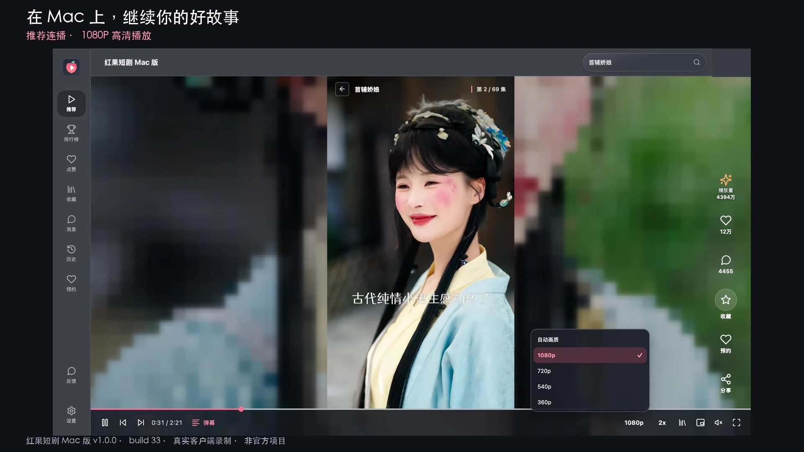
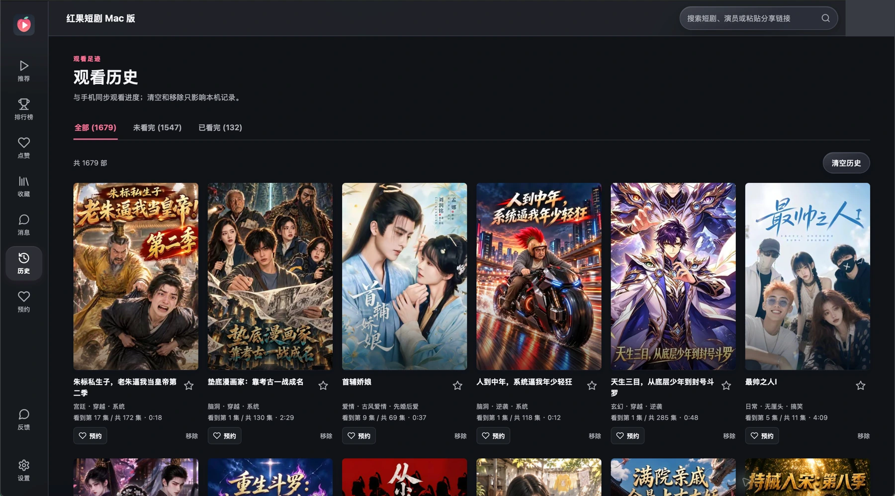

# 红果短剧 Mac 版｜macOS 桌面客户端（非官方）

**在 Mac 上看红果短剧，手机片单接着追**

红果短剧电脑版（Mac），适用于 macOS 13+，提供 Apple Silicon / Intel 通用 DMG 安装包。

[下载 v1.2.0 完整 DMG](https://github.com/StriveToLearnCode/hongguo-short-drama-macos/releases/download/v1.2.0/HongguoMac-1.2.0-universal.dmg) · [项目官网](https://strivetolearncode.github.io/hongguo-short-drama-macos/) · [校验文件](https://github.com/StriveToLearnCode/hongguo-short-drama-macos/releases/download/v1.2.0/SHA256SUMS.txt) · [反馈问题](https://github.com/StriveToLearnCode/hongguo-short-drama-macos/issues)

这是由 `StriveToLearnCode` 独立维护的非官方 macOS 客户端，与红果短剧官方无隶属关系。本仓库用于发行与反馈，客户端源码目前未公开。欢迎自愿 Star 支持项目，不影响下载或使用。

## 红果短剧 Mac 客户端能做什么？

- **账号与手机片单**：支持红果账号登录，查看收藏、观看历史、点赞和预约；账号云同步处于测试阶段，具体限制见下文。
- **大屏高清追剧**：在线搜索短剧、分季选集、自动连播；按片源提供最高 1080p 画质。
- **Mac 桌面播放**：支持最高 4 倍速、全屏和置顶小窗，游客模式的收藏与续播位置保存在本机。
- **直接下载安装**：前往 [GitHub Releases 下载红果短剧 Mac 版](https://github.com/StriveToLearnCode/hongguo-short-drama-macos/releases/latest)，或查看 [Mac 版下载与安装指南](https://strivetolearncode.github.io/hongguo-short-drama-macos/#install)。

## 1.2.0｜桌面体验升级

- 重新整理偏好设置：分组导航、深浅外观、弹幕与画面调节、快捷键、缓存用量和启动页。
- 新增选集离线下载、任务管理、MP4 / 合集导出，以及本机片单搜索、多选、收藏夹和备份。
- 最高 4 倍速；准备期间使用 2 倍速，失败自动回退。整合拖动进度、自动连播、账号同步、目录与片源保护修复，补齐 180p。
- 更新包校验后可安装并重启，替换失败恢复旧应用；反馈服务未配置时保留本机未发送记录。

macOS 13+，Apple Silicon / Intel 通用包，build 42。覆盖安装保留本机数据。[发行说明](RELEASE_NOTES.md)。尚未经过 Apple 公证；实体 Intel、macOS 13、国际短信及外部播放设备仍待对应验收。

## 1.1.6｜多剧切集缓存修复

- 下一集准备完整本地缓存，已完整播放的分段视频也保留为 MP4，减少连播、上下集和重复选集的等待。
- 在 Apple M4 Pro / macOS 15.3.1 的原生 WKWebView 中，实测《玩家无响应第二季》《首辅娇娘》《灾年逆袭：我靠穿越养全家》《持械入宋：第八季》。预加载完成后的连播和上下集首帧约 0.2–0.6 秒；自动实际为 1080p，另测 540p。
- 已缓存非相邻选集约 0.5 秒；未缓存跨集另测到约 2.6–5.3 秒，不能承诺所有首次选集都零等待。

macOS 13+，Apple Silicon / Intel 通用包，build 41。覆盖安装保留本机数据。[发行说明](RELEASE_NOTES.md) · [真实播放验收数据](https://github.com/StriveToLearnCode/hongguo-short-drama-macos/releases/download/v1.1.6/PLAYBACK_VALIDATION.json)。实体 M1 / Intel 和 macOS 13 未验证。

## 1.1.5｜片源、切集预加载与老板键修复

- 旧单视频接口返回空响应时，尝试公开批量接口，只接受当前视频对应的片源。
- 分段预加载不可用时提前准备下一集完整文件缓存；老板键可在设置中关闭，未设置过的用户默认不占用大写字母。
- 隔离版 build 40 实测片源回退和 360p 首帧解码；真实切集等待时间及实体 Intel 尚待验证。

macOS 13+，Apple Silicon / Intel 通用包，build 40。覆盖安装保留本机数据。详情及验证限制见 [完整发行说明](RELEASE_NOTES.md)。

## 1.1.4｜播放进度与自动连播修复

- 每集使用独立播放器，修复切集进度串用和上一集事件影响下一集的问题。
- 修复分段连接中断后把短视频前缀误判为整集结束；启动停住时受限重试，持续失败有明确提示。
- 修复分段播放切换 3 倍速的进度恢复，以及回到开头时的多余下载。
- 通过真实片源原生 WKWebView、倍速与暂停、404 项 Python 和 70 组 JavaScript 回归；4 项 Python 测试跳过。

macOS 13+，Apple Silicon / Intel 通用包，build 39。覆盖安装保留本机数据。详情及验证限制见 [完整发行说明](RELEASE_NOTES.md)。

## 1.1.2｜更新说明弹窗显示修复

- 修复 v1.1.1 更新说明正文竖排、重叠和显示不完整的问题。
- 保留自动连播、切集进度隔离、提前中断恢复与全屏播放修复。
- 已验证深浅主题与不同窗口尺寸下的实际弹窗显示。

macOS 13+，Apple Silicon / Intel 通用包，build 37。覆盖安装保留本机数据。详情见 [完整发行说明](RELEASE_NOTES.md)。

## 1.1.1｜自动连播与全屏播放修复

- 修复播放完一集后，下一集停住、需要手动暂停再播放的问题。
- 切集时隔离上一集的播放进度，避免新一集从错误位置开始或误记为已看完。
- 视频提前中断时尝试从当前进度恢复，持续失败会提示重试，避免误跳下一集。
- 全屏切集、页面重新加载和视频方向尚未识别时，播放区域保持适配全屏。

macOS 13+，Apple Silicon / Intel 通用包，build 36。覆盖安装保留本机数据。测试范围与限制见 [完整发行说明](RELEASE_NOTES.md)。

## 1.1.0｜完整剧库与加载优化

- 首页优先加载，云端同步随后继续；启动只更新有变化的资源，升级复用校验通过的运行组件。
- 支持的片源首段准备好即可播放，并改进下一集预加载、选集和拖动进度时的衔接。
- “找剧”默认浏览全部剧库，滚动持续加载；显示真实已加载数量，不再局限当天推荐。
- 评论与消息移至右上角头像菜单，调整深浅主题和紧凑窗口体验。

macOS 13+，Apple Silicon / Intel 通用包，build 35。覆盖安装保留本机数据。具体测试范围与限制见 [完整发行说明](RELEASE_NOTES.md)。

## 1.0.1 修复更新

- 修复历史移除后又回来、撤销保存被覆盖，以及清空后旧云端记录回流的问题；移除和清空只影响本机显示，手机端观看进度保留。
- 推荐一轮结束后继续向平台获取下一轮，跨轮过滤重复剧目并保留平台顺序。平台暂未提供新内容时仍可能没有更多推荐。
- 改进账号会话保存、设备绑定和同步节奏；平台要求验证或冷却时暂停自动请求。

本次修复经过本地自动化与合成接口页面测试，没有使用真实账号进行联机回归。Apple 绑定账号兼容、手机/Mac 共存和推荐观看行为回传仍未完成验证，账号同步继续作为测试功能提供。

## 1.0 大版本：同一个账号，换个屏幕接着追

Mac 登录同一红果账号，可查看收藏、观看历史、预约和点赞记录；Mac 的新操作也可以回写账号云记录。旧 Mac 游客记录先预览，再由本人选择是否上传。账号凭据保存在 macOS 钥匙串，不同账号的片单与待上传操作隔离。

**账号云同步现开放测试。** 账号云端读取、身份恢复及部分写入已有真实账号验证；手机屏幕上的双向变化、跨设备进度冲突及所有平台验证状态尚未全部实机覆盖，不承诺实时、无延迟或所有账号均可用。不登录也可使用游客模式，游客收藏与续播位置保存在本机。

[完整发行说明](RELEASE_NOTES.md) · [历史版本记录](CHANGELOG.md)

## 新版真实演示

[观看 30 秒新版客户端静音演示](https://strivetolearncode.github.io/hongguo-short-drama-macos/assets/v1.0.0-b33-intro.mp4) · [下载演示视频](https://github.com/StriveToLearnCode/hongguo-short-drama-macos/releases/download/v1.0.0/HongguoMac-1.0.0-intro.mp4)

本轮图片与视频均来自 v1.0.0 build 33 实际客户端，个人账号资料已隐藏；视频、海报与内容归各自权利方所有。

## 找剧与桌面体验

- 收藏、观看历史、预约、点赞与账号消息集中查看，评论列表接近底部自动分页。
- 搜索联想、分享链接直达、分季选集、推荐连播；来源结果可能不完整。
- 按本集片源选择 1080P、720P、540P 和 360P，具体可用画质取决于来源与设备。
- 最高 4 倍速、按住加速、全屏与可选置顶小窗；弹幕和深浅色外观可切换。
- 下一集预加载、播放重试与缓存整理；来源持续不可用时仍可能播放失败。

## 下载与安装

macOS 13+，Apple Silicon / Intel 通用包。Apple Silicon 已构建与验收；物理 Intel Mac、macOS 13 和全新 macOS 用户账户仍待实机验证。

1. 下载 v1.2.0 DMG，可用同版 `SHA256SUMS.txt` 核验；安装包 SHA-256 为 `b1550df71a30d04617b2ca17c9ef941528bba963ac7002646fa137409bf43664`。
2. 打开 DMG，将“红果短剧 Mac 版”拖入“应用程序”，覆盖安装保留已有收藏、历史与设置。
3. 从“应用程序”启动。安装包采用临时签名，尚未经过 Apple 公证。如果系统仅提示无法验证开发者，可在“系统设置 → 隐私与安全性”中针对本应用确认打开。若提示恶意软件或“将损坏你的电脑”，停止安装并反馈，不要关闭系统防护。
4. 首次启动所需组件内置；找剧、播放与账号同步需要联网。

旧版检查更新失败时，可手动覆盖安装。新版应用内下载会显示进度并核验可信摘要，下载完成后由用户选择保存位置及安装。摘要校验不等于 Apple 公证。

## 支持这个项目

这个 Mac 客户端是我自己在维护。如果你用着还不错，欢迎在仓库右上角点个 ⭐ Star。有问题可以 [提 Issue](https://github.com/StriveToLearnCode/hongguo-short-drama-macos/issues)，尽量带上版本、系统和复现步骤。

是否 Star 都不影响下载和使用。项目是非官方客户端，源码暂未公开。

## 红果短剧电脑版常见问题

### 红果短剧能在 Mac 电脑上看吗？

本项目提供独立维护的红果短剧 Mac 桌面客户端，系统要求为 macOS 13 及以上。Apple Silicon / Intel 使用同一个通用安装包；具体实机验证范围见“下载与安装”。

### 红果短剧 Mac 版在哪里下载？

在本仓库的 [Releases](https://github.com/StriveToLearnCode/hongguo-short-drama-macos/releases/latest) 页面下载 DMG 安装包与同版校验文件。安装步骤见上文“下载与安装”，后续版本以 Releases 为准。

### 可以同步手机上的红果收藏和观看历史吗？

支持同一红果账号的收藏、历史、点赞和预约云记录，账号同步目前开放测试。平台验证、账号类型与同步节奏可能影响可用性，不承诺所有账号均可用或实时同步。不登录也可以使用游客模式。

### 这是红果官方客户端吗？支持 Windows 吗？

这是非官方社区项目，与红果短剧官方无隶属关系；本项目当前仅提供 macOS 安装包，不提供 Windows 或 Android 安装包。

## 隐私与反馈

默认发送匿名启动、播放结果与预设失败类别统计，使用随机安装 ID；包含处理器架构与 macOS 大版本，断网时在本机限量保存至多 7 天。不上传机型、观看内容、用户路径或错误详情，可在安装界面或设置中关闭；本机日志不自动上传。账号同步需要向内容服务读取和回写你主动使用的账号记录。

反馈时请提供版本、macOS 版本、操作步骤和错误文字，不要公开账号凭据或完整私人日志。“设置”中的诊断摘要可手动预览和复制，不会自动发送。

第三方组件和来源见 [NOTICE.md](NOTICE.md)。品牌、封面和视频归各自权利方所有。
