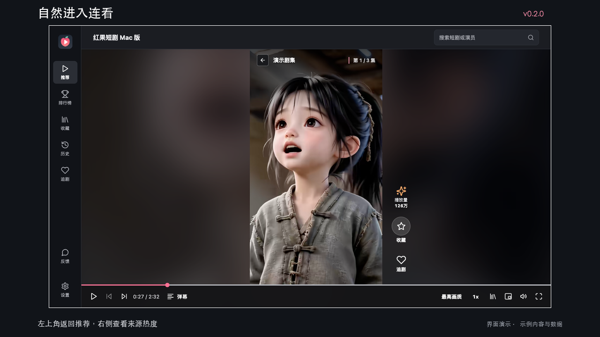
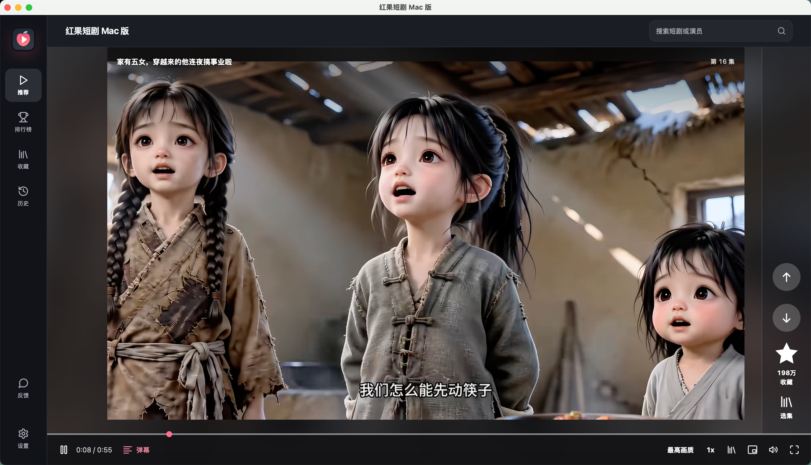
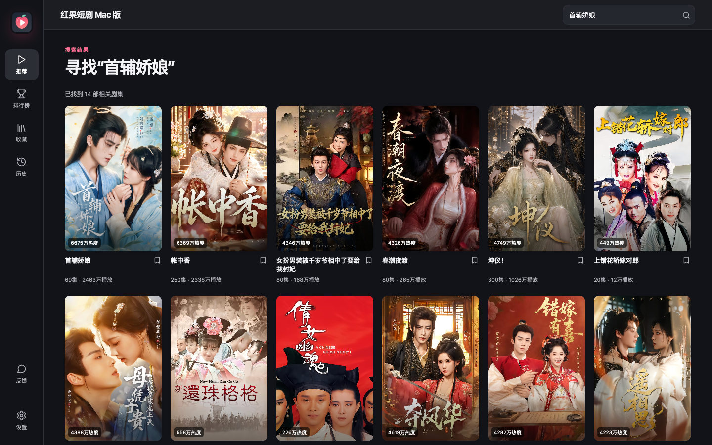

# 红果短剧 Mac 版（非官方）

**macOS 短剧播放器 · Mac 下载与安装说明 · 历史续播**

[下载 v0.2.9 完整 DMG](https://github.com/StriveToLearnCode/hongguo-short-drama-macos/releases/download/v0.2.9/HongguoMac-0.2.9-universal.dmg) · [下载页](https://strivetolearncode.github.io/hongguo-short-drama-macos/) · [校验文件](https://github.com/StriveToLearnCode/hongguo-short-drama-macos/releases/download/v0.2.9/SHA256SUMS.txt) · [反馈问题](https://github.com/StriveToLearnCode/hongguo-short-drama-macos/issues)

**觉得这个项目不错？** 欢迎点击仓库右上角的 **Star** 支持我们继续完善。Star 完全自愿，不影响下载或使用。

想在 Mac 上看短剧？这里提供红果短剧 Mac 版（非官方）的 macOS 安装包、应用截图、安装说明和问题反馈。支持 macOS 13 及以上，Apple Silicon 已实测；物理 Intel Mac 仍待实机验收。

这是由 `StriveToLearnCode` 独立维护的 Mac 客户端，与红果短剧官方和 Windows 原发行者没有维护关系。此仓库用于发行与反馈，不包含客户端源码；v0.2.9 安装包内置首次运行所需的第三方组件。

## v0.2.9 搜索与相关季匹配修复

**v0.2.9 是最新稳定版。** 修复“暂时无法搜索”和选剧下拉框持续匹配的问题：搜索与其他季查找统一使用官方网页搜索与名称检索，新安装无需等待本机索引建立，也可在线找剧。一个来源失败时保留可用结果；手动重试会重新取结果，快速换词不混入旧结果。

公开搜索只提供有限结果，界面会提示可能不完整；不能保证完整片库或未来来源一直可用。诊断摘要增加搜索失败原因码，匿名统计不上传搜索词、剧名或错误原文。覆盖安装保留收藏、历史、预约和设置，本版不包含登录与账号同步实验。

[下载 v0.2.9 DMG](https://github.com/StriveToLearnCode/hongguo-short-drama-macos/releases/download/v0.2.9/HongguoMac-0.2.9-universal.dmg) · [核对 SHA-256](https://github.com/StriveToLearnCode/hongguo-short-drama-macos/releases/download/v0.2.9/SHA256SUMS.txt) · [版本说明](https://github.com/StriveToLearnCode/hongguo-short-drama-macos/releases/tag/v0.2.9)

## v0.2.7 播放稳定性修复

**v0.2.7 的更新内容：** 改善画质切换后的播放失败、误标高清旧缓存、半成品缓存竞争，以及暂停拖动后续播位置未保存的问题。空或长度不一致的视频下载不会覆盖原成品。

**覆盖安装保留收藏、历史、设置和观看位置。** 本版不包含登录与账号同步实验。指定 1080p 会检查实际文件尺寸和编码；分辨率不会提升源素材的码率或细节。受限刷新与经过校验的同集公开回退可恢复部分来源故障，持续拒绝或缺少内容仍可能失败。

[下载 v0.2.7 DMG](https://github.com/StriveToLearnCode/hongguo-short-drama-macos/releases/download/v0.2.7/HongguoMac-0.2.7-universal.dmg) · [核对 SHA-256](https://github.com/StriveToLearnCode/hongguo-short-drama-macos/releases/download/v0.2.7/SHA256SUMS.txt) · [版本说明](https://github.com/StriveToLearnCode/hongguo-short-drama-macos/releases/tag/v0.2.7)

## v0.2.6 播放与画质修复

**v0.2.6 的更新内容：** 如果近期遇到只能播放 360p、切换画质失败或视频准备失败，请先更新到这一版。已修复视频取址与部分低档轨道的兼容问题，并完成本机试播验证。

**覆盖安装保留收藏、历史、设置和观看位置。** 仍可接着看之前的剧，无需清理用户数据。该版本不包含登录或账号同步实验。

支持来源提供的高清轨道；缺少 1080p 时不会把较低轨道静默标为 1080p。分辨率不等于源视频码率和画面细节，持续不可用或没有兼容轨道的片源仍可能失败。

[下载 v0.2.6 DMG](https://github.com/StriveToLearnCode/hongguo-short-drama-macos/releases/download/v0.2.6/HongguoMac-0.2.6-universal.dmg) · [核对 SHA-256](https://github.com/StriveToLearnCode/hongguo-short-drama-macos/releases/download/v0.2.6/SHA256SUMS.txt) · [版本说明](https://github.com/StriveToLearnCode/hongguo-short-drama-macos/releases/tag/v0.2.6)

## v0.2.3 启动恢复、找剧与小窗

**v0.2.3 的更新内容：** 本机服务启动时意外退出会清理并重试一次；应用运行时检查已预约剧季的新集。新增逐步建立的本机剧目索引，在线搜索首屏失败时可显示明确标记的部分结果并重试。推荐流优先寻找未展示、未观看内容，但可能增加有上限的目录请求。

小窗去掉顶部白边，可从顶部透明区域拖动；置顶、恢复按钮移到底部并自动收起。点击应用内“下载更新”后，首页横幅会显示下载进度、校验和保存结果，失败可重试。

已知限制：部分剧目的新季检查仍可能因来源搜索分页未收敛而失败，不会以不完整结果覆盖预约基线。没有完成与 v0.2.2 同片源、同画质的 CPU 和首帧对照测试，不宣称播放提速或 CPU 占用下降。

[下载 v0.2.3 DMG](https://github.com/StriveToLearnCode/hongguo-short-drama-macos/releases/download/v0.2.3/HongguoMac-0.2.3-universal.dmg) · [核对 SHA-256](https://github.com/StriveToLearnCode/hongguo-short-drama-macos/releases/download/v0.2.3/SHA256SUMS.txt) · [版本说明](https://github.com/StriveToLearnCode/hongguo-short-drama-macos/releases/tag/v0.2.3)

## v0.2.2 播放切换与故障归因

v0.2.2 切集和切画质的完整准备失败时，不再重复请求同一地址，当前播放保持不变；视频地址和 CDN 请求的 HTTP 异常按来源阶段归类。匿名播放尝试保留起始传输方式。片源持续不可用时客户端仍无法保证播放。

已知限制：部分剧目的追剧更新检查可能因来源搜索分页未收敛而失败；不会以不完整结果覆盖追剧基线。完整追剧流程和物理 Intel 等设备仍待验收。

[下载 v0.2.2 DMG](https://github.com/StriveToLearnCode/hongguo-short-drama-macos/releases/download/v0.2.2/HongguoMac-0.2.2-universal.dmg) · [核对 SHA-256](https://github.com/StriveToLearnCode/hongguo-short-drama-macos/releases/download/v0.2.2/SHA256SUMS.txt) · [版本说明](https://github.com/StriveToLearnCode/hongguo-short-drama-macos/releases/tag/v0.2.2)

## v0.2.1 播放兼容性修复

v0.2.1 默认完整准备视频，减少渐进播放失败后的重复视频地址请求；内容源返回异常内容时明确提示。安装就绪标记包含后端源码指纹，升级或回退会重建对应服务，保留本机收藏、历史和观看位置。

[下载 v0.2.1 DMG](https://github.com/StriveToLearnCode/hongguo-short-drama-macos/releases/download/v0.2.1/HongguoMac-0.2.1-universal.dmg) · [核对 SHA-256](https://github.com/StriveToLearnCode/hongguo-short-drama-macos/releases/download/v0.2.1/SHA256SUMS.txt) · [版本说明](https://github.com/StriveToLearnCode/hongguo-short-drama-macos/releases/tag/v0.2.1)

## v0.2.0 真实 App 演示

v0.2.0 的画面更新仍保留在 v0.2.7 中：观看达到一集后自动从上下切剧进入上下切集；左上角返回推荐，切换时不自动展开选集。视频旁的操作随窗口定位，收藏上方只读展示来源提供的播放量、热度或追剧人数；没有数据时不会编造数值。

[下载 v0.2.0 正式 DMG](https://github.com/StriveToLearnCode/hongguo-short-drama-macos/releases/download/v0.2.0/HongguoMac-0.2.0-universal.dmg) · [核对 SHA-256](https://github.com/StriveToLearnCode/hongguo-short-drama-macos/releases/download/v0.2.0/SHA256SUMS.txt) · [阅读版本说明](https://github.com/StriveToLearnCode/hongguo-short-drama-macos/releases/tag/v0.2.0)

[观看约 12 秒真实 App 录制](https://github.com/StriveToLearnCode/hongguo-short-drama-macos/releases/download/v0.2.0/HongguoMac-0.2.0-intro.mp4) · 静音，连续采集 v0.2.0 WKWebView 窗口中的实际播放、返回推荐和手动选集；没有浏览器示例页或合成片段。视频内容、封面与剧名来自内容来源，权利归相应权利方。Apple Silicon / macOS 15.3.1 已实测；物理 Intel、M5/macOS 26、macOS 13 和全新账户仍待完整验收。

**v0.1.10 更新：**新增本机追剧列表与手动检查、完整标题核对后选择其他季、长选集定位和最高 3 倍速。设置提供手动诊断摘要；升级后展示一次更新说明，确认后同版本不再弹出。更新下载区分已传输量与校验阶段。覆盖安装保留收藏、历史和观看进度；物理 Intel Mac 仍待实机验收。

**旧版检查更新失败？** 已安装的旧逻辑无法远程修复。直接从本页下载 v0.2.9 DMG，拖入“应用程序”覆盖安装一次；之后可使用新版的备用检查来源。

## 当前功能

**打开就看**

- 启动进入推荐播放；上下切换剧目，同一部剧播完后自动接下一集。
- 推荐流继续加载后续内容，并尽量避开近期已展示或观看过的剧；本机收藏和观看记录可参与轻量重排。寻找新剧目时会有限向前查询，偏好不上传。
- 搜索剧名或演员，浏览热播、推荐和新剧榜，结果可直接进入播放器。

**连续观看与预约**

- 选集侧栏显示简介、分组和指定集数定位，并保留已识别关联季的入口；收藏、历史、集数与观看位置保存在本机。
- “查找其他季”按标题提供候选及完整标题，需自行核对并手动选择；从所选条目的第 1 集开始。候选可能遗漏或误匹配，查找期间保留当前播放，切换失败保留原媒体和已存进度。
- 本机预约列表在应用运行时约每分钟检查已知剧季的新集，新季仍定期检查；也可手动检查和标记已知晓。后台通知需自行授权，预约与收藏、历史相互独立。
- 播放中切换最高画质、1080p、720p、540p、360p；具体可用画质取决于片源，切换失败会保留原播放。
- 最高 3 倍速、全屏、可拖动及临时置顶的小窗与键盘快捷操作；弹幕可随时开关。
- 中断后重试并尝试其他画质；针对部分 HE-AACv2 音轨做兼容处理。
- 下一集预加载默认开启以减少切集等待；低配机器或流量敏感时可在设置中关闭。
- 深色、浅色或跟随系统；应用内反馈、使用帮助与新版本提示。

收藏与观看记录不与手机红果账号同步。片单和播放可用性取决于内容来源及网络；本机偏好重排不代表官方账号推荐。

默认发送匿名启动、播放成功和预设失败类别统计，通过随机安装 ID 去重；启动事件增加处理器架构与 macOS 大版本，断网时在本机限量保存至多 7 天。不上传机型、观看内容、用户路径或错误详情，可在安装界面或“设置 → 匿名使用统计”中关闭，关闭后删除待发事件。本机诊断日志仍可自行查看，不自动上传。

“设置”中的本次运行诊断摘要由用户手动生成、预览、复制；不读取旧日志、观看记录、剧名或 URL，也不会自动发送或附到反馈中。

## 安装

**v0.2.9 已通过 166 项 Python、40 个前端测试文件、20 项遥测接收端测试与原生遥测测试，并完成双架构构建和安装包校验。** 隔离页面验证无本机索引的在线搜索、完整剧名、错误重试和快速换词；本机安装后原生窗口已显示搜索结果，原有收藏、历史和预约保留。物理 Intel Mac、全新 macOS 账户和其他系统版本尚待实机验收。

1. 下载 [`HongguoMac-0.2.9-universal.dmg`](https://github.com/StriveToLearnCode/hongguo-short-drama-macos/releases/download/v0.2.9/HongguoMac-0.2.9-universal.dmg)，与同版的 [`SHA256SUMS.txt`](https://github.com/StriveToLearnCode/hongguo-short-drama-macos/releases/download/v0.2.9/SHA256SUMS.txt) 对照。DMG 的 SHA-256 应为 `9204853dd0c0575152831d50d66cede8eeb01a956ee9f25198875babf96c4529`。
2. 打开 DMG，将“红果短剧 Mac 版”拖入“应用程序”。
3. 从“应用程序”启动。本版采用临时签名，尚未经过 Apple 公证。如果系统**仅提示无法验证开发者**，可在“系统设置 → 隐私与安全性”中针对本应用确认打开。若提示恶意软件或“将损坏你的电脑”，停止安装并[反馈](https://github.com/StriveToLearnCode/hongguo-short-drama-macos/issues)；不要关闭系统防护。
4. 首次启动会从安装包在本机配置 Python、Java 和内容服务，完成后自动进入推荐页；安装运行环境不需要联网，搜索和播放仍需联网。

应用会检查正式发行版。取得可信校验摘要时可在应用内下载并校验 DMG；首页横幅显示下载量、进度、校验与保存状态，再由用户选择保存位置并手动覆盖安装。旧版清单缺少校验信息时仍打开下载页。本次运行内仅在服务器范围请求及文件标识核对通过时尝试续传，退出后不保留临时下载进度。下载提示变化不代表提速，SHA-256 校验也不等于发布者代码签名。

## 常见问题

**首次安装失败？** 在安装界面重试，或打开安装日志查看失败阶段。若提示内置运行组件校验失败，请重新下载 DMG 并核对 SHA-256。

**播放中断？** 在播放器中重试、切换画质，或到“设置 → 播放服务”检查连接。反馈时请提供版本、macOS 版本、剧名、集数、操作步骤和错误文字；不要公开账号凭据或完整私人日志。

**提示“所有签名服务失败”？** v0.1.2 起已修复代理误转发 `127.0.0.1` 的问题；若仍报错，请反馈完整错误文字及代理软件名称。

**如何清理缓存？** 先退出应用，再检查 `~/Library/Application Support/HongguoMac/backend/downloads/.stream_cache`。只删除此目录的视频缓存不会删除收藏和历史；下次播放会重新下载。应用启动时会整理旧缓存。

**如何卸载？** 删除“应用程序”中的客户端。如需清除本机记录、匿名统计设置和运行组件，再删除 `~/Library/Application Support/HongguoMac`。

## 来源

第三方组件与来源见 [NOTICE.md](NOTICE.md)。红果品牌、封面和视频内容归各自权利方所有。客户端源码目前未公开，本站不暗示官方授权或 Apple 公证代表内容授权。
